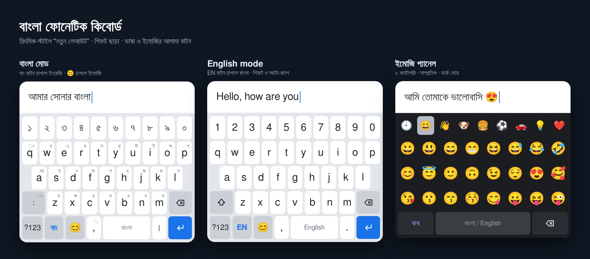

<div align="center">

# 🌼 পপি কিবোর্ড

**ইংরেজি হরফে টাইপ করুন, বাংলা লিখুন: সহজ, সুন্দর, নিজের মতো করে।**

ফোনেটিক (রিদমিক-স্টাইল) বাংলা কিবোর্ড · Android · Kotlin · কোনো বাইরের লাইব্রেরি নেই

[](../../actions/workflows/android.yml)




<sub>ছবিটি অ্যাপের আসল লেআউট কোড থেকে আঁকা প্রিভিউ; আসল ফোনের স্ক্রিনশট নয়।</sub>

</div>

---

## 📥 ইনস্টল করুন

1. **[Releases](../../releases)** পাতা থেকে সর্বশেষ `PopyKeyboard-x.y.apk` নামিয়ে ইনস্টল করুন (অজানা উৎস থেকে ইনস্টলের অনুমতি লাগতে পারে)।
2. অ্যাপটি খুলুন → **"কিবোর্ড সেটিংস খুলুন"** → *পপি কিবোর্ড* চালু করুন।
3. **"কিবোর্ড পাল্টান"** চেপে *পপি কিবোর্ড* বেছে নিন।
4. অ্যাপের টেস্ট বক্সে লিখে দেখুন: `amar sonar bangla` → আমার সোনার বাংলা 🎉

---

## ✍️ ব্যবহার বিধি

### ১. প্রথম পাঠ: যেমন বলেন তেমন লিখুন

| টাইপ করুন | পাবেন | | টাইপ করুন | পাবেন |
|---|---|---|---|---|
| `amar` | আমার | | `prem` | প্রেম |
| `bangla` | বাংলা | | `kotha` | কথা |
| `ut⇧tor` | উত্তর | | `xoma` | ক্ষমা |
| `jnnan` | জ্ঞান | | `rrrsssi` | ঋষি |
| `ghorri` | ঘড়ি | | `swopn` | স্বপ্ন |

> 💡 **যুক্তাক্ষর নিজে নিজে জোড়া লাগে।** আলাদা রাখতে চাইলে মাঝে `o` দিন: `kotha` = কথা (ক্থ নয়)।

### ২. স্বর

| `o` | `a` | `i` | `ii` | `u` | `uu` | `rrr` | `e` | `oi` | `oo` | `ou` |
|---|---|---|---|---|---|---|---|---|---|---|
| অ | আ | ই | ঈ | উ | ঊ | ঋ | এ | ঐ | ও | ঔ |

ব্যঞ্জনের পরে এরা **কার** হয়ে বসে: `ka` = কা, `ki` = কি, `kii` = কী, `krrr` = কৃ।

### ৩. ব্যঞ্জন

| | | | | | |
|---|---|---|---|---|---|
| `k` ক | `kh` খ | `g` গ | `gh` ঘ | `nng` ঙ | `c` চ |
| `ch` ছ | `j` জ | `jh` ঝ | `nnn` ঞ | `tt` ট | `tth` ঠ |
| `dd` ড | `ddh` ঢ | `nn` ণ | `t` ত | `th` থ | `d` দ |
| `dh` ধ | `n` ন | `p` প | `f` ফ | `b` ব | `bh` ভ |
| `m` ম | `y` য় (স্বাধীন) | `z` য | `r` র | `l` ল | `s` স |
| `ss` শ | `sss` ষ | `h` হ | `x` ক্ষ | `rr` ড় | `rrh` ঢ় |

### ৪. ফলা, রেফ ও হসন্ত

| কী | টাইপ | উদাহরণ |
|---|---|---|
| র-ফলা | ব্যঞ্জনের পরে `r` | `prem` = প্রেম, `str` = স্ত্র |
| রেফ | `r` + ব্যঞ্জন | `dhorm` = ধর্ম, `kormo` = কর্ম |
| য-ফলা | ব্যঞ্জনের পরে `z` | `bidza` = বিদ্যা |
| ব-ফলা | ব্যঞ্জনের পরে `w` | `swopn` = স্বপ্ন |
| র‍্য | শব্দের শুরুতে `rz`, অন্যত্র `rqz` | `rzab` = র‍্যাব |
| হসন্ত | `,,` (কমা দুইবার) | |

### ৫. ⇧ শিফট, `o` ও `q` — তিন কী, তিন কাজ

কিবোর্ড "লোভী" (গ্রিডি) পদ্ধতিতে কাজ করে: লম্বা কী-ক্রম আগে মেলে (`tt` = ট, `nn` = ণ) এবং **তালিকার ১৬৩টি** ব্যঞ্জন-জোড়া নিজে যুক্ত হয় (`kt` = ক্ত, `nd` = ন্দ)। বাকি জোড়া আলাদা থাকে (`kf` = কফ)। **যেখানে এই নিয়ম আপনার চাওয়া দেয় না, শুধু সেখানেই** এই তিন কী:

| কী | কাজ |
|---|---|
| **যুক্ত** (বাংলায় শিফট কী, একবার ট্যাপ) | পরের কী-র স্বয়ংক্রিয় মিলন বন্ধ: **ব্যঞ্জনের আগে = জোর করে যুক্ত**, **স্বরের আগে = স্বাধীন স্বর** |
| `o` | ব্যঞ্জনের পরে অ-ধ্বনি: কিছু লেখে না, কিন্তু জোড়া **যুক্ত হতে দেয় না** (`koto` = কতো, `kto` = ক্তো) |
| `q` | শুধু বিশেষ বর্ণ ও চিহ্ন (নিচের টেবিল) |

**শিফট ট্যাপ:** শব্দ লেখার মাঝে শিফট চাপলে শব্দের শেষে নীল `s` মার্কার ভাসে (প্রিভিউয়ে `⇧`); পরের কী-তে কাজ হয়ে `s` চলে যায়। বারবার চাপলেও একটিই কাজ করে। **Backspace** দিলে মুছে যায়। শব্দের শুরুতে চাপলে কিছু হয় না।

| টাইপ | ফল | শিফট ছাড়া |
|---|---|---|
| `t⇧t` | ত্ত | `tt` = ট |
| `d⇧dh` | দ্ধ | `ddh` = ঢ |
| `n⇧n` | ন্ন | `nn` = ণ |
| `s⇧s` | স্স | `ss` = শ |
| `r⇧r` | র্র | `rr` = ড় |
| `k⇧f` | ক্ফ | `kf` = কফ |
| `bo⇧i` | বই | `boi` = বৈ |
| `k⇧i` | কই | `ki` = কি |

(`⇧` মানে বাংলা মোডে **যুক্ত** (শিফট) কী একবার ট্যাপ।)

**`q` কী — শুধু বিশেষ বর্ণ:**

| টাইপ | ফল | উদাহরণ |
|---|---|---|
| `qq` | ঁ | `caqqd` = চাঁদ |
| `qw` | ঃ | `duqwkh` = দুঃখ |
| `ng` | ং | `bangla` = বাংলা |
| `qt` | ৎ | `hotthaqt` = হঠাৎ |
| `qk` | ৳ | |
| `qn` | ঞ (তালিকাভুক্ত জোড়ায় যুক্ত, যেমন জ্ঞ) | `jqn` = জ্ঞ |
| `qs` | স্বাধীন ষ | `kqs` = কষ |
| `qz` `qh` `qx` | স্বাধীন য, হ, ক্স | `kqz` = কয |
| `q.` `q,` | ? ! | `kq.` = ক? |
| `qr` | ঋ / ঋ-কার (`rrr`-ও একই) | `qrsssi` = ঋষি, `kqr` = কৃ |

`q` + অন্য কোনো অক্ষর দিলে `q` শুধু চলে যায়, কিছু করে না।

> র-ফলা/য-ফলার পরে কিছু নিজে যুক্ত হয় না (র-ফলার পরে য-ফলা চলে: `brzan` = ব্র্যান)। য় (`y`) কখনো ফলা হয় না, তবে তার পরে য-ফলা বসে: `yz` = য়্য।


#### গ্রিডি মোড বন্ধ করলে (নন-গ্রিডি)

সেটিংসে "গ্রিডি মোড" সুইচ (ডিফল্টে চালু)। **বন্ধ** করলে:

- **কিছুই নিজে যুক্ত হয় না**; `র` ও `য` স্বাধীন (`kr` = কর, `kz` = কয)।
- **শিফট পোস্টফিক্স:** লেখার **পরে** শিফট চাপলে শেষ ব্যঞ্জনটি আগেরটির সাথে যুক্ত হয়; কারের পরে চাপলে কার স্বাধীন স্বর হয়। প্রতিটি জোড়ার পরে একবার করে শিফট (`bj⇧r⇧` = ব্জ্র)।
- দ্বিত্বে (`tt` = ট) মাঝে `o`: `tot⇧` = ত্ত। `o`-এর পরে শিফট = স্বাধীন অ।
- `qn`, `qs` স্বাধীন; `jqn⇧` = জ্ঞ।

| টাইপ | ফল |
|---|---|
| `km⇧` | ক্ম |
| `kr⇧` | ক্র |
| `kz⇧` | ক্য |
| `rk⇧` | র্ক |
| `tot⇧` | ত্ত |
| `bj⇧r⇧` | ব্জ্র |
| `ka⇧` | কআ |
| `ko⇧` | কঅ |
| `jqn⇧` | জ্ঞ |

গ্রিডি **চালু** থাকলে শিফট আগের মতো ব্যঞ্জনের **আগে** (`t⇧t` = ত্ত, `bo⇧i` = বই)। গ্রিডি চালুতেও `qn` শুধু তালিকাভুক্ত জোড়ায় নিজে যুক্ত হয় (`jqn` = জ্ঞ), অন্যত্র স্বাধীন (`kqn` = কঞ; জোর করতে `k⇧qn` = ক্ঞ)।

### ৬. 💡 কী-র গায়েই পথ দেখানো

শব্দ লেখার সময় প্রতিটি কী-র গায়ে নীল রঙে ছোট করে দেখা যায়, **এরপর ওই কী চাপলে কী আসবে**। কার, ফলা, খ/ঘ/ছ, যুক্তাক্ষর সবই। মুখস্থ করতে হয় না। 🔴 লাল `o`, 🟢 সবুজ `q` আর 🔵 নীল `s` (শিফট) মার্কার দেখায় কিবোর্ড কী ধরেছে।

### ৭. ✂️ ২ সেকেন্ড চেপে ধরলে এডিট কমান্ড

কী-র নিচে একটা লাইন ভরতে থাকে; ভরে গেলে কমান্ড চলে। তার আগে ছেড়ে দিলে সাধারণ অক্ষরই বসে।

| `x` | `c` | `v` | `z` | `y` | `a` |
|---|---|---|---|---|---|
| কাট | কপি | পেস্ট | আনডু | রিডু | সব নির্বাচন |

### ৮. 🎛️ বাটন ও সেটিংস

| | |
|---|---|
| **বাং / EN** | বাংলা ↔ ইংরেজি বদল। চেপে ধরলে কিবোর্ড বদলানোর মেনু। নম্বর/ইমেইল/পাসওয়ার্ড ফিল্ডে নিজে ইংরেজিতে যায় |
| **😊** | ইমোজি প্যানেল (প্রায় ৮৮০টি, সাম্প্রতিক আগে) |
| **যুক্ত** (বাংলায় শিফট) | একবার ট্যাপ = জোর করে যুক্ত / স্বাধীন স্বর (ওপরে ৫ নম্বর); গ্রিডি বন্ধ থাকলে লেখার পরে। ইংরেজিতে এটি **শিফট ⇧**: বড় হাতের অক্ষর, দুবার চাপলে Caps Lock |
| 🔊 **সাউন্ড** | ৭ ধরনের আওয়াজ: ক্লিক, টাইপরাইটার, মেকানিক্যাল, বাবল পপ, পানির ফোঁটা, কাঠের টোকা, রেট্রো বিপ। মাত্রা ও চালু/বন্ধ ঠিক করা যায় |
| 📳 **ভাইব্রেশন** | চালু/বন্ধ ও ১–১০০% মাত্রা |
| 💡 **সাজেশন বার** | ডিকশনারি (৪.৩ লাখের বেশি শব্দ) থেকে সর্বোচ্চ ৮টি সাজেশন; স্পেস/এন্টারে বানান নিজে ঠিক হয় (`tumii` → তুমি)। সেটিংসে বন্ধ করা যায় (ডিফল্টে চালু) |
| 🔤 **প্রিভিউ প্যানেল** | নম্বর সারির ওপরে মাঝখানে চলমান শব্দের ইংরেজি অক্ষর দেখায় (ডিফল্টে বন্ধ) |
| 📏 **উচ্চতা** | ৭০%–১৫০% |
| 🌙 | ডার্ক মোড স্বয়ংক্রিয় |

📖 সব নিয়মের পূর্ণাঙ্গ তালিকা: **[টাইপিং ম্যানুয়াল](docs/bangla_phonetic_keyboard_manual.md)**

---

## 👨‍💻 ডেভেলপার

**আব্দুল্লাহ আল মামুন**
বিএ/এমএ (ইংরেজী)
সরকারি তোলারাম কলেজ, নারায়ণগঞ্জ
📧 [mamun995599@gmail.com](mailto:mamun995599@gmail.com)

মতামত, ভুল বা নতুন আইডিয়া থাকলে [Issues](../../issues) এ জানান। 🙏

---

<details>
<summary><b>🛠️ ডেভেলপারদের জন্য: বিল্ড, টেস্ট ও কোড কাঠামো</b></summary>

### বিল্ড
Android Studio (Koala বা নতুন) দিয়ে ফোল্ডারটি খুলুন; Gradle sync নিজেই হবে। টার্মিনালে: `gradle assembleDebug` (Gradle 8.7, Java 17)।

### কোড কাঠামো (`app/src/main/java/com/popykeyboard`)

| ফাইল | কাজ |
|---|---|
| `BanglaPhonetic.kt` | টাইপিং ইঞ্জিন (Android-মুক্ত, টেস্টযোগ্য) |
| `PopyDictionary.kt` | অটো কারেক্ট ও সাজেশন (`assets/popy_words.dat`) |
| `BanglaKeyboardService.kt` | IME সার্ভিস: composing বাফার, কমিট, ব্যাকস্পেস, এন্টার |
| `KeyboardLayouts.kt` | কী-এর সারি ও লেআউট |
| `KeyboardRoot.kt`, `KeyView.kt` | কিবোর্ড UI, প্রিভিউ প্যানেল, কী আঁকা |
| `EmojiPanel.kt`, `EmojiData.kt` | ইমোজি প্যানেল ও ডেটা |
| `Feedback.kt` | কী-চাপার শব্দ (থিমসহ) ও কম্পন |
| `SettingsActivity.kt` | চালু করার ধাপ, সেটিংস, চিটশিট, ডেভেলপার তথ্য |

### টেস্ট
`app/src/test` এ JUnit টেস্ট `typing_cases.tsv` (৪৫০+ উদাহরণ, পিসি ভার্সনের টেস্টের সাথে এক; নন-গ্রিডির আলাদা ফাইল) দিয়ে ইঞ্জিন যাচাই করে: `gradle test`।
নতুন নিয়মের জন্য `BanglaPhonetic.kt` এর টেবিলে ম্যাপিং যোগ করে tsv-তে `টাইপ<TAB>ফল` লাইন দিন।

### সাউন্ড থিম
`python3 tools/make_sounds.py` (numpy লাগে) `res/raw/key_<থিম>_<ধরন>.wav` ফাইলগুলো বানায়। নতুন থিম যোগ করতে স্ক্রিপ্টে একটি ফাংশন লিখুন, এরপর `Feedback.kt` এর `THEMES` তালিকায় নাম দিন।

</details>

<details>
<summary><b>🚀 অটো বিল্ড ও সাইন্ড রিলিজ (GitHub Actions)</b></summary>

`.github/workflows/android.yml`:

| কখন | কী হয় |
|---|---|
| প্রতিটি push / Pull Request | ইউনিট টেস্ট + **debug APK** (Actions → Artifacts) |
| `main`-এ push | সাইন্ড APK বানিয়ে **[`latest` প্রি-রিলিজ](../../releases/tag/latest)** আপডেট করে |
| `v*` ট্যাগ (যেমন `v1.1`) | সাইন্ড APK বানিয়ে **স্থায়ী GitHub Release** দেয় |
| Actions → Run workflow | হাতে চালানো; সাইন্ড APK Artifacts-এ আসে |

**কিছুই সেটআপ করতে হয় না।** রিপোতে `signing/popy-release.jks` নামে একটি কী দেওয়া আছে; secret সেট না থাকলে workflow ওটা দিয়েই APK সাইন করে। প্রতিবার একই কী, তাই নতুন সংস্করণ পুরনোটার ওপর আপডেট হিসেবে বসে।

> ⚠️ এই কী রিপোতে খোলা থাকে (পাসওয়ার্ড `popykeyboard`), তাই রিপো পাবলিক হলে যে কেউ এই কী দিয়ে সাইন করতে পারে। শখের অ্যাপের জন্য এটা চলে, কিন্তু আসল নিরাপত্তা চাইলে নিচের "নিজের কী" ধাপ করুন।

**নিজের গোপন কী (ঐচ্ছিক)**
1. কীস্টোর বানান (হারালে আপডেট দেওয়া যাবে না, নিরাপদে রাখুন):
   ```
   keytool -genkeypair -v -keystore release.jks -alias bangla -keyalg RSA -keysize 2048 -validity 10000
   ```
2. base64: `base64 -w0 release.jks` (macOS: `base64 -i release.jks`)
3. রিপোতে *Settings → Secrets and variables → Actions* এ চারটি secret:
   `KEYSTORE_BASE64`, `KEYSTORE_PASSWORD`, `KEY_ALIAS` (এখানে `bangla`), `KEY_PASSWORD`

চারটি secret সেট থাকলে workflow নিজে থেকেই ভেতরের কী-র বদলে এগুলো ব্যবহার করে। মনে রাখবেন, কী বদলালে আগে ইনস্টল করা অ্যাপের ওপর আপডেট বসবে না; আগের অ্যাপ মুছে নতুনটা ইনস্টল করতে হবে।

**স্থায়ী রিলিজ:** `git tag v1.1 && git push origin v1.1`

ট্যাগ `v1.2.3` হলে `versionName = 1.2.3`; `versionCode` = workflow run নম্বর।

</details>
